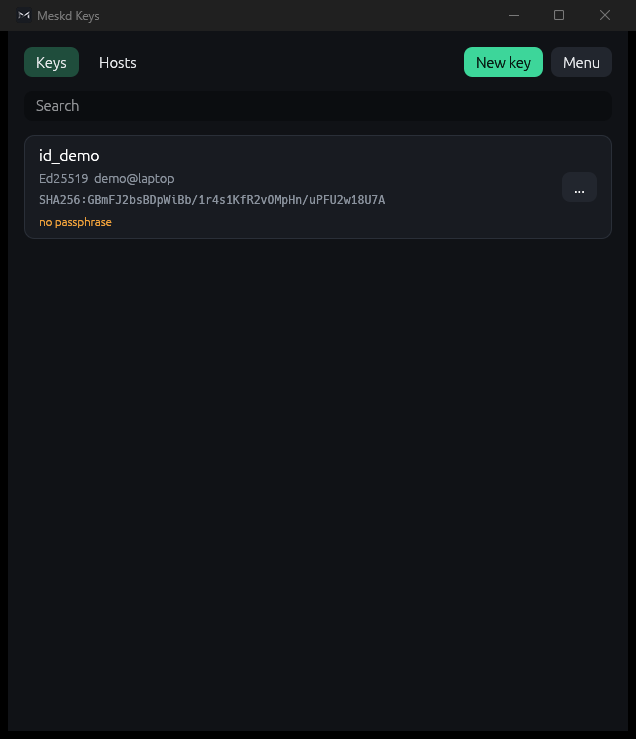
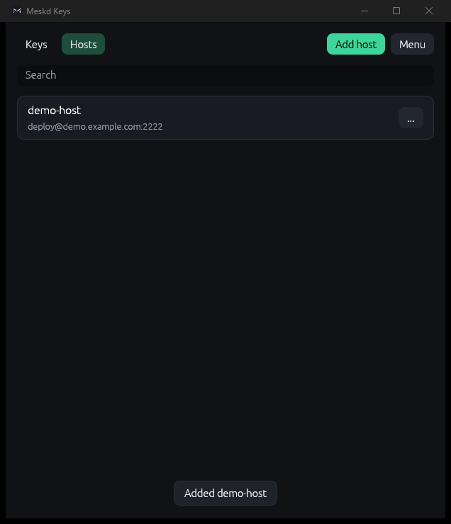

<p align="center">
  
</p>

<h1 align="center">Meskd Keys</h1>

<p align="center">SSH keys and hosts on your desktop. Read them at a glance, make new ones, keep them tidy.</p>

<p align="center">
  
  
</p>

## Download

Get the latest build from [Releases](https://github.com/MESKD-INTELLIGENCE/meskd-keys/releases/latest).

- **Windows 10 and 11**: unzip and run `meskd-keys.exe`.
- **Linux x86_64** (Ubuntu 22.04+, Debian 12+, Fedora, Arch): extract, then run `./install.sh` to add it to your app menu, or start `./meskd-keys` directly.

## What it does

- Finds the keys in `~/.ssh` and shows the type, size, comment and SHA256 fingerprint
- Flags keys without a passphrase, loose file permissions, public keys with no private half, and files that are not in OpenSSH format
- Creates Ed25519 or RSA 4096 keys, with or without a passphrase
- Imports keys you already have, with owner-only permissions
- Copies a public key to the clipboard with one click
- Lists your SSH config hosts and adds or removes them without touching the rest of the file

## Where it works

`~/.ssh` on Linux, `%USERPROFILE%\.ssh` on Windows. Use `--ssh-dir <folder>` to point it somewhere else.

## Security

- No network code. Nothing leaves the computer.
- Passphrases you type are only used to encrypt the key being created. Existing passphrases are never asked for and never stored.
- Private keys are written with `0600` on Linux. On Unix, keys with looser permissions are flagged and can be fixed from the menu.
- Deleting a key removes both halves and cannot be undone, so the app asks first.

See [SECURITY.md](SECURITY.md) for the details.

## Building

Rust 1.95 or newer.

```sh
cargo build --release
```

On Linux you also need the X11 and Wayland headers:

```sh
sudo apt install libxkbcommon-dev libwayland-dev libx11-dev
```

## License

[MIT](LICENSE)
